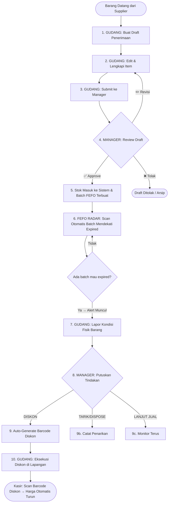

# 🏪 Alur Lengkap Gudang — Wiramart PRD v3.0

> Dokumen ini menjelaskan **seluruh alur logika gudang** secara end-to-end setelah fitur PRD v3.0 ditambahkan.
> Mencakup: Penerimaan Barang, Manajemen Batch FEFO, Radar Alert, Laporan Kondisi, Keputusan Manager, dan Eksekusi Lapangan.

---

## 🗺️ Peta Aktor & Hak Akses Gudang

| Aktor | Role di Sistem | Apa yang boleh dilakukan |
|---|---|---|
| **Petugas Gudang** | `employee` | Buat draft penerimaan, edit draft, submit ke manager, scan FEFO radar, lapor kondisi fisik barang, eksekusi diskon di lapangan |
| **Admin Shift** | `admin` + `ADMIN_SHIFT` | **TIDAK BISA** akses gudang. Hanya kasir & manajemen shift. |
| **Manager (Dosen)** | `admin` + `MANAGER` | Approve/Revisi/Tolak penerimaan barang, lihat semua batch, putuskan tindakan FEFO (diskon/tarik/lanjut), generate barcode diskon |

> [!IMPORTANT]
> **Admin Shift ≠ Manager.** Admin Shift hanya mengelola kasir dan shift karyawan. Seluruh keputusan gudang adalah **hak eksklusif Manager**.

---

## 🔄 ALUR BESAR (Overview)



---

## 📦 FASE 1 — Penerimaan Barang Masuk

### Langkah 1: Petugas Gudang Buat Draft

**Siapa:** `employee` (petugas toko/gudang)
**Endpoint:** `POST /api/gudang/penerimaan`

Petugas membuat **draft penerimaan** (seperti form pengisian nota masuk barang) dengan data:
- Nama supplier (opsional)
- Catatan pengiriman (opsional)
- Daftar item barang: nama produk, kode batch, jumlah, HPP, tanggal kadaluarsa, catatan kondisi fisik

**Validasi otomatis:**
- Produk harus terdaftar & aktif di sistem
- Tanggal kadaluarsa tidak boleh sudah lewat
- Minimal 1 item

Draft terbuat dengan status: `DRAFT`

---

### Langkah 2: Petugas Edit Draft (Opsional)

**Endpoint:** `PATCH /api/gudang/penerimaan/{id}`

Kalau ada salah input, petugas bisa edit draft selama statusnya masih `DRAFT` atau `REVISED` (dikembalikan manager untuk diperbaiki). **IDOR-safe:** hanya pembuat draft sendiri yang bisa edit.

---

### Langkah 3: Petugas Submit ke Manager

**Endpoint:** `POST /api/gudang/penerimaan/{id}/submit`

Petugas "klik tombol ajukan" → status berubah ke `SUBMITTED`. Draft kini masuk **antrian Manager**.

**Limit:** Maksimal **10 submit per 24 jam** per petugas (rate limiter, anti-spam).

---

### Langkah 4: Manager Review & Putuskan

**Endpoint (Approve):** `POST /api/admin/gudang/penerimaan/{id}/approve`
**Endpoint (Revisi):** `POST /api/admin/gudang/penerimaan/{id}/revisi`
**Endpoint (Tolak):** `POST /api/admin/gudang/penerimaan/{id}/tolak`

> [!IMPORTANT]
> **Manager harus sudah Check-In sesi kerja hari ini** sebelum bisa approve. Jika Manager belum mulai sesi, sistem menolak dengan error 403.

| Keputusan | Status berubah | Efek |
|---|---|---|
| **Approve** | `APPROVED` | Stok langsung masuk ke sistem, batch FEFO terbuat |
| **Revisi** | `REVISED` | Dikembalikan ke petugas + catatan, petugas bisa edit ulang |
| **Tolak** | `REJECTED` | Draft diarsipkan, stok tidak masuk |

---

### ✅ Saat Approved — ACID Transaction Terjadi:

```
Untuk setiap item dalam draft:
  1. Insert baris baru ke tabel stock_batches (batch FEFO baru terbuat)
  2. Hitung expiry_class: HARIAN (≤2 hari) / PENDEK (≤14 hari) / PANJANG (>14 hari)
  3. Update stock_qty produk di tabel master products (+qty)
  4. Update status draft → APPROVED + simpan ID manager yang approve
  5. Catat audit_log
```

**Semua operasi ini adalah 1 transaksi ACID** — kalau 1 gagal, semua dibatalkan (rollback).

---

## 📊 FASE 2 — Radar FEFO & Monitoring Batch

Setelah barang masuk, sistem otomatis memantau **semua batch yang mendekati expired**.

### Cara Kerja FEFO Radar

**Engine:** `fefoAlertService.ts`

1. Sistem **scan semua batch aktif** yang `expiry_date` ≤ 7 hari ke depan
2. Setiap batch dikategorikan ke alert level:

| Alert Level | Kondisi | Arti |
|---|---|---|
| `H1` (`H1_KRITIS`) | Expired dalam 1 hari | 🔴 KRITIS — harus segera ditangani |
| `H3` (`H3_URGENT`) | Expired dalam 3 hari | 🟠 URGENT |
| `H5` (`H5_WASPADA`) | Expired dalam 5 hari | 🟡 WASPADA |
| `H7` (`H7_MONITOR`) | Expired dalam 7 hari | 🔵 MONITOR |

3. Alert disimpan di tabel `fefo_alerts` di database
4. Badge merah muncul di UI gudang

> [!NOTE]
> FEFO Radar hanya refresh saat **petugas klik tombol scan manual** — bukan auto-refresh tiap detik. Ini sengaja untuk menghindari spam request ke server (bug lama sudah diperbaiki).

---

## 📋 FASE 3 — Laporan Kondisi Fisik (oleh Petugas Gudang)

Saat radar mendeteksi alert, petugas wajib **turun ke gudang dan lihat kondisi fisik barang** lalu buat laporan.

**Endpoint:** `POST /api/gudang/fefo-alerts/{id}/lapor`

Petugas mengisi:
- Deskripsi kondisi fisik barang (kemasan penyok? jamuran? bau? dll)
- Foto kondisi (opsional)
- Rekomendasi tindakan dari sudut pandang petugas

Status alert berubah ke: `REPORTED` → masuk antrian keputusan Manager.

---

## ⚖️ FASE 4 — Keputusan Manager (Tindakan FEFO)

**Endpoint:** `POST /api/admin/gudang/fefo-alerts/{id}/decide`

Manager membuka laporan kondisi yang diajukan petugas, lalu memutuskan:

| Keputusan | Kode | Efek Otomatis di Sistem |
|---|---|---|
| **Diskon** | `DISKON` | ✨ **Auto-generate barcode diskon khusus** untuk batch itu |
| **Tarik/Dispose** | `TARIK` | Batch ditandai "ditarik", stok dikurangi |
| **Lanjut Jual Normal** | `LANJUT` | Alert di-dismiss, monitoring dilanjutkan |

> [!IMPORTANT]
> Hanya **Manager** yang bisa putuskan. Admin Shift ❌ tidak bisa akses endpoint ini.

---

### 🏷️ Auto-Generate Barcode Diskon (Jika Pilih DISKON)

Saat Manager pilih `DISKON`, sistem otomatis:
1. Generate **kode barcode unik** (format: `DISC-{batch_code}-{timestamp}`)
2. Simpan barcode + persentase diskon yang ditetapkan Manager
3. Kembalikan barcode ke layar Manager

Manager kemudian **cetak/kirim barcode** ke petugas gudang.

---

## 🛠️ FASE 5 — Eksekusi Lapangan (oleh Petugas Gudang)

**Endpoint:** `POST /api/gudang/fefo-alerts/{id}/execute`

Petugas gudang pergi ke fisik barang, **tempel label barcode diskon** ke produk, lalu klik "Tandai Sudah Dieksekusi" di sistem.

Status alert berubah ke: `EXECUTED`.

**Efek di kasir:** Saat kasir scan produk tersebut, sistem deteksi barcode diskon → **harga otomatis turun** sesuai persentase yang ditetapkan Manager.

---

## 🧵 Ringkasan Status Flow Lengkap

### Penerimaan Barang:
```
DRAFT → SUBMITTED → APPROVED ✅
                 ↘ REVISED → (edit) → SUBMITTED
                 ↘ REJECTED ❌
```

### FEFO Alert:
```
DETECTED → REPORTED → DECIDED
                    ↘ (DISKON) → EXECUTED ✅
                    ↘ (TARIK)  → DISPOSED ✅
                    ↘ (LANJUT) → MONITORING
```

---

## 🔒 Separation of Duty Summary

| Aksi | Employee (Gudang) | Admin Shift | Manager (Dosen) |
|---|---|---|---|
| Buat draft penerimaan | ✅ | ❌ | ❌ |
| Edit draft | ✅ (milik sendiri) | ❌ | ❌ |
| Submit ke manager | ✅ (milik sendiri) | ❌ | ❌ |
| Approve/Revisi/Tolak penerimaan | ❌ | ❌ | ✅ |
| Lihat semua batch | ❌ | ❌ | ✅ |
| Scan FEFO radar | ✅ | ❌ | ✅ (view) |
| Lapor kondisi fisik | ✅ | ❌ | ❌ |
| Putuskan tindakan FEFO | ❌ | ❌ | ✅ |
| Generate barcode diskon | ❌ | ❌ | ✅ (otomatis) |
| Eksekusi lapangan | ✅ | ❌ | ❌ |

---

> **Filosofi Desain:** Petugas gudang adalah "tangan" yang kerja fisik. Manager adalah "otak" yang ambil keputusan strategis. Admin Shift hanya tahu dunia kasir. Mereka tidak pernah campur aduk.
