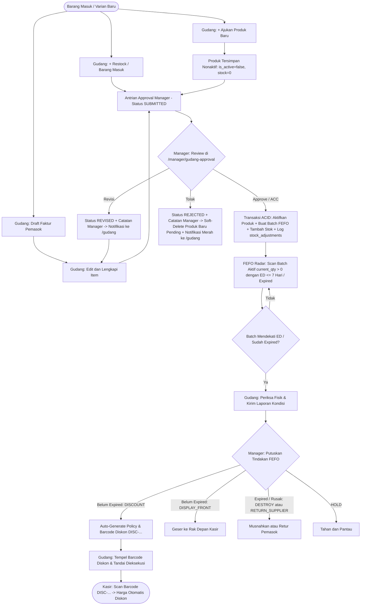

# ALUR LENGKAP GUDANG - WIRAMART (PRD v3.0 - REVISI PRODUKSI)

Dokumen ini menjelaskan seluruh alur operasional, validasi keamanan, dan alur data modul Gudang Wiramart secara end-to-end. Cakupan meliputi Penerimaan Barang (Restock, Faktur Pemasok, Usulan Produk Baru), Persetujuan Manager, Pusat Notifikasi Dua Arah, Manajemen Batch FEFO, Radar Kedaluwarsa, Keputusan Manager, dan Eksekusi Lapangan.

---

## 1. PETA AKTOR DAN HAK AKSES GUDANG

| Aktor | Role di Sistem | URL Utama | Hak Akses Modul Gudang |
|---|---|---|---|
| Petugas Gudang | `employee` | `/gudang` | Cek stok fisik, ajukan `+ Restock / Barang Masuk`, ajukan `+ Ajukan Produk Baru`, buat/edit/submit draft Faktur Pemasok, terima notifikasi keputusan Manager, scan FEFO Radar, lapor kondisi fisik, eksekusi tindakan lapangan. Tidak dapat menambah stok langsung tanpa ACC Manager dan tidak dapat melihat HPP master katalog. |
| Admin Shift | `admin` (`ADMIN_SHIFT`) | `/admin/produk`, `/gudang` (pantau) | Akses mode pantau (read-only) stok dan batch FEFO di `/gudang`, serta unggah foto nota dan lihat Tabel Buku Nota Supplier. Tidak dapat memutasi stok langsung di gudang, tidak dapat menyetujui barang masuk, dan tidak dapat memutuskan tindakan FEFO. |
| Manager (Dosen) | `admin` (`MANAGER`) | `/manager/gudang-approval`, `/gudang` | Hak eksklusif menyetujui, meminta revisi, atau menolak penerimaan barang dan usulan produk baru (termasuk penyesuaian Harga Jual/HPP saat ACC), melihat seluruh batch FEFO, serta menetapkan tindakan FEFO (`DISCOUNT`, `DISPLAY_FRONT`, `DESTROY`, `RETURN_SUPPLIER`, `HOLD`) dan penerbitan barcode diskon. |

Catatan Pemisahan Tugas: Admin Shift bukan Manager. Seluruh persetujuan barang masuk, pengaktifan produk baru dari gudang, dan keputusan FEFO merupakan hak eksklusif Manager.

---

## 2. DIAGRAM ALUR BESAR



---

## 3. FASE 1 - PENGAJUAN BARANG MASUK DAN PRODUK BARU

Seluruh jalur masuk barang dari petugas gudang wajib melewati 2-layer approval Manager dan wajib menyertakan Tanggal Kedaluwarsa (`expiry_date >= hari ini WIB`).

### 3.1 Jalur A: Restock Cepat (`+ Restock / Barang Masuk`)
- Aktor: Petugas Gudang (`employee`) di `/gudang`.
- Endpoint: `POST /api/kasir/gudang`.
- Perilaku Sistem:
  - Untuk `employee`, sistem tidak langsung menambah stok produk. Sistem membuat draft penerimaan berstatus `SUBMITTED` secara otomatis dengan 1 item (produk terpilih, qty, `expiryDate` wajib `>= hari ini WIB`, kode batch, dan catatan).
  - Stok di Kasir dan Buyer tetap tidak berubah sampai Manager menekan Approve.
  - Untuk `MANAGER` yang melakukan restock langsung, sistem tetap mewajibkan `expiryDate >= hari ini WIB` dan langsung mencatat batch + log `stock_adjustments`.

### 3.2 Jalur B: Faktur Pemasok Multi-Item (Tab `Faktur Pemasok & Penerimaan`)
- Aktor: Petugas Gudang (`employee`) atau Admin (untuk arsip nota) di `/gudang`.
- Endpoint:
  - Buat draft: `POST /api/gudang/penerimaan` (status awal `DRAFT`).
  - Ubah draft (hanya saat `DRAFT` atau `REVISED`, IDOR-safe khusus pembuat draft): `PATCH /api/gudang/penerimaan/{id}`.
  - Kirim ke antrian Manager: `POST /api/gudang/penerimaan/{id}/submit` (status berubah ke `SUBMITTED`).
- Validasi Wajib:
  - Produk harus aktif di sistem, minimal 1 item.
  - `expiryDate` wajib diisi pada setiap item dan tidak boleh melewati hari ini (WIB), termasuk divalidasi ulang saat submit.
  - Rate limiter: maksimal 10 kali submit per 24 jam per petugas.

### 3.3 Jalur C: Usulan Produk Baru (`+ Ajukan Produk Baru`)
- Aktor: Petugas Gudang (`employee`) di `/gudang`.
- Endpoint: `POST /api/gudang/produk-baru` (dilindungi `stockSubmitLimiter`).
- Validasi & Pengamanan:
  - Penolakan duplikasi nama produk (case-insensitive) dan duplikasi barcode terhadap produk aktif/pending.
  - Harga jual usulan wajib `> Rp 0`, HPP wajib `>= 0` dan `<= Harga Jual`, stok awal `>= 1`, serta `expiryDate` wajib `>= hari ini WIB`.
  - Petugas gudang diblokir (`403`) bila mengakses langsung `POST /api/admin/produk`.
- Penyimpanan Transaksional:
  - Produk baru dibuat dengan `is_active = false` dan `stock_qty = 0` sehingga belum tampil di Kasir maupun Buyer.
  - Bersamaan dibuatkan draft `stock_receive_drafts` berstatus `SUBMITTED` dengan penanda `[USULAN PRODUK BARU]` dan 1 baris `stock_receive_items` berisi stok awal, batch, HPP usulan, dan `expiryDate`.

---

## 4. FASE 2 - REVIEW MANAGER DAN PUSAT NOTIFIKASI DUA ARAH

### 4.1 Review di `/manager/gudang-approval`
- Endpoint:
  - Setujui: `POST /api/admin/gudang/penerimaan/{id}/approve`
  - Minta Revisi: `POST /api/admin/gudang/penerimaan/{id}/revisi`
  - Tolak: `POST /api/admin/gudang/penerimaan/{id}/tolak`
- Prasyarat Wajib: Manager harus sudah melakukan Check-In sesi kerja harian (`manager_duty_log`). Jika belum, sistem menolak dengan error `403`.
- Fitur Koreksi Harga saat ACC Usulan Produk Baru:
  - Pada item `[USULAN PRODUK BARU]`, Manager dapat mengubah **Harga Jual (`overrideSellingPrice`)** dan **HPP (`overrideCostPrice`)** sebelum menyetujui.

### 4.2 Efek Keputusan Manager (ACID Transaction)

| Keputusan | Status Draft | Efek di Database |
|---|---|---|
| Approve (ACC) | `APPROVED` | Dalam 1 transaksi ACID: (1) jika produk baru nonaktif, aktifkan `is_active = true` dan terapkan harga jual/HPP final Manager; (2) buat baris baru di `stock_batches` dengan klasifikasi `HARIAN` (<= 2 hari), `PENDEK` (<= 14 hari), atau `PANJANG` (> 14 hari); (3) tambah `products.stock_qty`; (4) catat riwayat di `stock_adjustments`; (5) simpan ID Manager dan `audit_logs`. |
| Revisi | `REVISED` | Draft dikembalikan ke petugas gudang beserta `manager_note`. Stok tidak berubah. Petugas dapat mengedit dan submit ulang. |
| Tolak | `REJECTED` | Draft diarsipkan sebagai ditolak beserta `manager_note`. Stok tidak berubah. Jika pengajuan merupakan `[USULAN PRODUK BARU]`, produk pending (`is_active = false, stock_qty = 0`) otomatis di-soft-delete (`deleted_at`) agar tidak mengotori katalog. |

### 4.3 Notifikasi Keputusan Manager di Portal `/gudang`
- Endpoint sumber data: `GET /api/kasir/gudang` mengembalikan ringkasan `approvalNotifications` (7 hari terakhir, dibatasi per `employeeId` untuk karyawan dan seluruh toko untuk admin).
- Tampilan di `/gudang`:
  1. **Banner Peringatan Atas (Otomatis):** Muncul langsung di bagian atas halaman ketika terdapat usulan berstatus `REJECTED` atau `REVISED` yang belum dibaca, menampilkan nomor pengajuan, nama barang, alasan/catatan Manager, dan tombol pintasan ke tab `Ditolak` atau `Perlu Revisi`.
  2. **Tombol Lonceng Notifikasi di Header:** Menampilkan angka notifikasi belum dibaca (indikator merah untuk `REJECTED`/`REVISED`, indikator hijau untuk `APPROVED`) dan membuka daftar riwayat respons Manager 7 hari terakhir lengkap dengan tombol `Buka di Tab Penerimaan` dan `Tandai Semua Sudah Dibaca`.
  3. **Badge Tab & Auto-Sync:** Tab `Faktur Pemasok & Penerimaan` menampilkan lencana jumlah info/menunggu ACC, dan halaman `/gudang` otomatis menyinkronkan data secara senyap saat petugas kembali membuka tab browser (`visibilitychange` / `focus`).

---

## 5. FASE 3 - RADAR FEFO, LAPORAN KONDISI, DAN LARANGAN BARANG EXPIRED

### 5.1 Pemindaian FEFO Radar
- Engine: `fefoAlertService.ts`.
- Jadwal: berjalan otomatis setiap hari pukul 06:00 WIB (`/api/cron/scan-fefo`) dan dapat dipicu manual oleh petugas lewat tombol `Scan Radar FEFO`.
- Cakupan: seluruh batch aktif dengan `current_qty > 0` dan `expiry_date <= 7 hari ke depan` (termasuk yang sudah melewati tanggal kedaluwarsa). Kartu KPI `FEFO Exp (<= 7 Hari / Exp)` di `/gudang` dihitung dari kriteria yang sama agar selalu sinkron dengan daftar Radar.

| Alert Level | Kondisi Sisa Hari | Kategori |
|---|---|---|
| `H1` (`H1_KRITIS`) | Sudah expired atau sisa <= 1 hari | Kritis - wajib segera ditangani |
| `H3` (`H3_URGENT`) | Sisa 2 sampai 3 hari | Urgent |
| `H5` (`H5_WARNING`) | Sisa 4 sampai 5 hari | Waspada |
| `H7` (`H7_WATCH`) | Sisa 6 sampai 7 hari | Pantau |

### 5.2 Laporan Kondisi Fisik oleh Petugas Gudang
- Endpoint: `POST /api/gudang/fefo-alerts/{id}/lapor`.
- Petugas memeriksa kondisi fisik batch, mengisi catatan kondisi, melampirkan foto (opsional), dan memilih saran tindakan. Status laporan berubah dari `ALERT_ONLY` menjadi `SUBMITTED`.
- **Hard-Block Barang Expired:** Jika tanggal kedaluwarsa batch sudah terlewat (`expiry_date < hari ini WIB`), UI dan API memblokir saran `DISCOUNT` dan `DISPLAY_FRONT`/`RELOCATE` (status 422). Petugas hanya dapat menyarankan `DESTROY` atau `RETURN_SUPPLIER`.

### 5.3 Keputusan Tindakan oleh Manager
- Endpoint: `POST /api/admin/gudang/fefo-alerts/{id}/decide`.
- Pilihan keputusan (`manager_decision`):

| Keputusan | Kode Enum | Syarat | Efek di Sistem |
|---|---|---|---|
| Diskon Darurat | `DISCOUNT` | Wajib belum expired | Auto-generate kebijakan di `discount_policies` dan kode barcode unik `DISC-{batch_code}-{timestamp}` di `discount_barcodes`. |
| Majukan ke Rak Depan | `DISPLAY_FRONT` | Wajib belum expired | Instruksi pemindahan ke etalase depan kasir. |
| Musnahkan | `DESTROY` | Semua kondisi (wajib/izinkan untuk expired) | Instruksi pemusnahan fisik dan pencatatan kerugian/mutasi. |
| Retur ke Pemasok | `RETURN_SUPPLIER` | Semua kondisi (wajib/izinkan untuk expired) | Instruksi pengembalian ke pemasok/konsinyasi. |
| Tahan dan Pantau | `HOLD` | Belum expired | Ditahan sementara untuk pemantauan lanjutan. |

- **Hard-Block Berlapis:** Apabila batch sudah expired, endpoint `decide` maupun endpoint `execute` menolak `DISCOUNT` dan `DISPLAY_FRONT` di level server (status 422), sehingga barang kedaluwarsa tidak mungkin lolos ke penjualan kasir.

### 5.4 Eksekusi Lapangan oleh Petugas Gudang
- Endpoint: `POST /api/gudang/fefo-alerts/{id}/execute`.
- Petugas menjalankan instruksi Manager di lapangan (menempelkan label `DISC-...` menutupi barcode asli, menggeser rak, memusnahkan, atau meretur barang), lalu menekan `Tandai Sudah Dieksekusi`.
- Status laporan berubah menjadi `EXECUTED` / `CLOSED`.
- Efek di Kasir: saat kasir memindai barcode `DISC-...`, harga otomatis terpotong sesuai kebijakan Manager dan kuota `remaining_qty` berkurang secara atomik.

---

## 6. RINGKASAN ALUR STATUS

Penerimaan Barang dan Usulan Produk Baru (`stock_receive_status`):

```text
DRAFT -> SUBMITTED -> APPROVED (Stok masuk & produk baru aktif)
                   -> REVISED  -> (Gudang perbaiki) -> SUBMITTED
                   -> REJECTED (Arsip, stok tidak masuk, produk baru pending soft-delete)
```

Laporan Kondisi dan FEFO (`condition_report_status`):

```text
ALERT_ONLY -> SUBMITTED -> MANAGER_REVIEW -> APPROVED -> EXECUTED -> CLOSED
                                          -> REJECTED
```

---

## 7. MATRIKS PEMISAHAN TUGAS (SEPARATION OF DUTY)

| Aksi | Petugas Gudang (`employee`) | Admin Shift (`ADMIN_SHIFT`) | Manager (`MANAGER`) |
|---|---|---|---|
| Pantau stok & baca Buku Nota Supplier di `/gudang` | Ya | Ya (mode pantau) | Ya |
| Buat / edit / submit draft Faktur Pemasok | Ya (milik sendiri) | Ya (unggah arsip nota) | Ya |
| Ajukan `+ Restock / Barang Masuk` (butuh ACC) | Ya (masuk `SUBMITTED`) | Tidak | Ya (langsung tercatat) |
| Ajukan `+ Ajukan Produk Baru` (butuh ACC) | Ya (masuk `SUBMITTED`) | Tidak | Tidak (input lewat `/manager/produk`) |
| Input langsung produk ke `/api/admin/produk` | Tidak (diblokir 403) | Ya | Ya |
| Lihat HPP master di katalog `/api/admin/produk` | Tidak (disamarkan) | Ya | Ya |
| Approve / Revisi / Tolak penerimaan & produk baru | Tidak | Tidak | Ya (wajib Check-In) |
| Scan FEFO Radar & lapor kondisi fisik | Ya | Tidak | Ya (pantau) |
| Putuskan tindakan FEFO & terbitkan barcode diskon | Tidak | Tidak | Ya (eksklusif) |
| Eksekusi tindakan FEFO di lapangan | Ya | Tidak | Tidak |
| Diskon / Geser Depan pada batch sudah expired | Diblokir (422) | Diblokir | Diblokir (422) |
