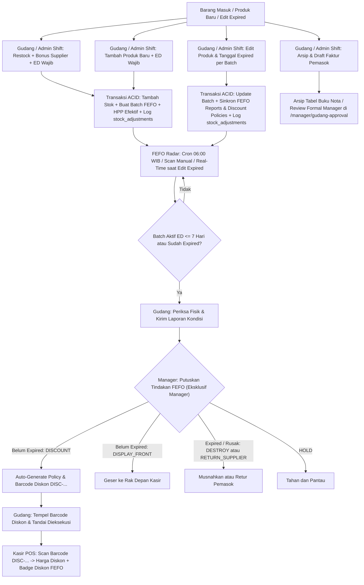

# ALUR LENGKAP GUDANG - WIRAMART (PRD v3.0 - REVISI PRODUKSI 20 NOV 2026)

Dokumen ini menjelaskan seluruh alur operasional, validasi keamanan, dan alur data modul Gudang Wiramart secara end-to-end sesuai kondisi produksi (`7444b01`). Cakupan meliputi Saling Backup Gudang & Admin Shift, Tambah Produk Baru, Restock + Bonus Supplier Gratis, Edit Produk & Tanggal Expired Multi-Batch, Arsip Faktur Pemasok, Radar FEFO, Keputusan Manager, dan Eksekusi Lapangan.

---

## 1. PETA AKTOR DAN HAK AKSES GUDANG

| Aktor | Role di Sistem | URL Utama | Hak Akses Modul Gudang |
|---|---|---|---|
| Petugas Gudang | `employee` | `/gudang` | Cek stok fisik, tambah produk baru langsung aktif (ED wajib), input `Restock / Barang Masuk` langsung (ED wajib + bonus supplier gratis), edit produk/stok/tanggal expired per batch (multi-batch), hapus produk (soft-delete), arsip Faktur Pemasok, scan FEFO Radar, lapor kondisi fisik, dan eksekusi keputusan FEFO Manager di lapangan. Tidak dapat memutuskan diskon/pemusnahan FEFO dan tidak dapat mengakses laporan keuangan. |
| Admin Shift | `admin` (`ADMIN_SHIFT`) | `/admin/produk`, `/gudang` | Saling backup penuh operasional barang & stok dengan Petugas Gudang di `/gudang` dan `/admin/produk` (tambah produk baru, restock + ED wajib + bonus supplier, edit produk & tanggal expired per batch, soft-delete, unggah foto & arsip Tabel Buku Nota Supplier). Tidak dapat memutuskan tindakan FEFO (`decide`) dan tidak dapat mengakses laporan keuangan/bagi hasil/pengaturan global. |
| Manager (Dosen) | `admin` (`MANAGER`) | `/manager/gudang-approval`, `/gudang` | Hak eksklusif menetapkan tindakan FEFO (`DISCOUNT`, `DISPLAY_FRONT`, `DESTROY`, `RETURN_SUPPLIER`, `HOLD`) dan penerbitan barcode diskon `DISC-...`, review draft faktur formal, kelola Master Supplier, audit seluruh log `stock_adjustments`, serta kontrol penuh laporan keuangan & mutasi stok. |

Catatan Pemisahan Tugas: Gudang dan Admin Shift saling mem-backup pengelolaan stok/katalog agar toko tidak terhenti saat salah satu berhalangan. Seluruh keputusan FEFO (diskon/retur/musnahkan) dan keuangan tetap eksklusif milik Manager.

---

## 2. DIAGRAM ALUR BESAR

---

## 3. FASE 1 - OPERASIONAL BARANG MASUK, PRODUK BARU, DAN EDIT EXPIRED

### 3.1 Jalur A: Restock / Barang Masuk Langsung (`POST /api/kasir/gudang`)
- Aktor: Petugas Gudang (`employee`), Admin Shift (`ADMIN_SHIFT`), dan Manager (`MANAGER`) di `/gudang`.
- Validasi Wajib:
  - `qtyAdd >= 1` (jumlah beli), `bonusQty >= 0` (bonus / barang gratis supplier, misal beli 10 dus gratis 1 dus).
  - `expiryDate` wajib diisi dan `>= hari ini WIB` (format `YYYY-MM-DD`).
- Efek Transaksi ACID:
  - Total fisik masuk `totalQty = qtyAdd + bonusQty` ditambahkan ke `products.stock_qty` dan dibuatkan batch baru di `stock_batches`.
  - HPP efektif dihitung otomatis: `(qtyAdd x unitCost) / (qtyAdd + bonusQty)` saat ada bonus gratis.
  - Log resmi tercatat di `stock_adjustments` dengan identitas petugas dan shift aktif.

### 3.2 Jalur B: Tambah Produk / Varian Baru Langsung Aktif (`POST /api/gudang/produk-baru`)
- Aktor: Petugas Gudang, Admin Shift, dan Manager di `/gudang`.
- Validasi & Pengamanan:
  - Anti-duplikasi nama produk (case-insensitive) dan anti-duplikasi barcode aktif (`409 Conflict`).
  - Harga jual > Rp 0, HPP >= 0, qty awal >= 1, dan `expiryDate` wajib `>= hari ini WIB`.
- Efek Transaksi ACID:
  - Produk langsung aktif (`is_active = true`) di Kasir & Gudang dengan batch awal FEFO dan jejak audit `stock_adjustments`.

### 3.3 Jalur C: Edit Produk, Koreksi Stok, & Edit Tanggal Expired per Batch (`PATCH` / `DELETE /api/gudang/produk/[id]`)
- Aktor: Petugas Gudang, Admin Shift, dan Manager di `/gudang`.
- Akses UI di `/gudang`:
  1. **Kartu Produk:** Produk berstok > 0 yang belum punya tanggal expired menampilkan indikator `Tanggal Expired belum diisi` + tombol cepat `Isi Exp`.
  2. **Modal `Edit Produk & Tanggal Expired`:** Memuat seluruh batch aktif produk (1 batch maupun multi-batch secara terpisah), dilengkapi tombol cepat (`Hari Ini`, `+30h`, `+6bln`, `+1th`) dan peringatan jika tanggal lewat.
  3. **Inline di Modal `Rincian Batch`:** Tombol `Isi Exp` / `Ubah Exp` langsung pada tiap kartu batch aktif.
- Validasi & Sinkronisasi Relasi Atomik:
  - Validasi kalender ketat (menolak tanggal tidak valid seperti `2026-02-31`, rentang tahun `2020-2040`).
  - Proteksi anti-IDOR: setiap `batchId` pada `batchUpdates` diverifikasi milik `productId` yang diedit (`404` bila melintas produk lain).
  - Koreksi stok pada produk multi-batch mempertahankan urutan FEFO dan menyinkronkan kuota `discount_policies` / `discount_barcodes`.
  - Pembaruan tanggal expired langsung menyinkronkan `product_condition_reports` (membuat/membuka ulang `ALERT_ONLY` bila masuk <= 7 hari, menutup alert hantu `ALERT_ONLY -> CLOSED` bila diperbaiki > 7 hari) dan memblokir diskon aktif bila batch berubah expired.
  - Mencatat audit `[EDIT EXPIRED GUDANG]` / `[EDIT PRODUK GUDANG]` di `stock_adjustments` dengan FK `batch_id` (untuk edit 1 batch) tanpa menggelembungkan metrik `Restock Hari Ini`.
  - `DELETE` melakukan soft-delete (`deleted_at`), menolkan stok/batch, menonaktifkan diskon terkait, dan menutup seluruh alert FEFO terbuka.

### 3.4 Jalur D: Faktur Pemasok Multi-Item & Buku Nota (`/api/gudang/penerimaan`)
- Mendukung unggah foto fisik nota (`invoice_photo_url`, validasi magic bytes JPEG/PNG/WebP maks 4 MB), tanggal faktur, Auto-Match teks nota, dan arsip **Tabel Buku Nota**.
- Jalur review formal Manager di `/manager/gudang-approval` (`approve`, `revisi`, `tolak`, wajib Check-In MOD) tetap aktif beserta notifikasi dua arah ke `/gudang`.

---

## 4. FASE 2 - RADAR FEFO, LAPORAN KONDISI, DAN LARANGAN BARANG EXPIRED

### 4.1 Pemindaian FEFO Radar (`fefoAlertService.ts`)
- Berjalan melalui 3 pemicu: Cron harian pukul **06:00 WIB** (`/api/cron/scan-fefo`), tombol manual `Scan Radar FEFO`, dan sinkronisasi real-time saat edit tanggal expired di `PATCH /api/gudang/produk/[id]`.
- Cakupan: seluruh batch aktif (`current_qty > 0`) dengan `expiry_date <= 7 hari ke depan` atau sudah expired.

| Alert Level | Kondisi Sisa Hari | Kategori |
|---|---|---|
| `H1` (`H1_KRITIS`) | Sudah expired atau sisa <= 1 hari | Kritis - wajib segera ditangani |
| `H3` (`H3_URGENT`) | Sisa 2 sampai 3 hari | Urgent |
| `H5` (`H5_WARNING`) | Sisa 4 sampai 5 hari | Waspada |
| `H7` (`H7_WATCH`) | Sisa 6 sampai 7 hari | Pantau |

### 4.2 Laporan Kondisi, Keputusan Eksklusif Manager, & Eksekusi Lapangan
- Laporan kondisi (`POST /api/gudang/fefo-alerts/{id}/lapor`): Gudang melaporkan kondisi fisik & saran (`ALERT_ONLY -> SUBMITTED`).
- Keputusan Manager (`POST /api/admin/gudang/fefo-alerts/{id}/decide`): Eksklusif Manager (`DISCOUNT` + auto-barcode `DISC-...`, `DISPLAY_FRONT`, `DESTROY`, `RETURN_SUPPLIER`, `HOLD`).
- Eksekusi lapangan (`POST /api/gudang/fefo-alerts/{id}/execute`): Gudang menempelkan stiker `DISC-...` atau mengeksekusi retur/pemusnahan (`EXECUTED -> CLOSED`).
- **Hard-Block Barang Expired (4 Lapis):** Batch dengan `expiry_date < hari ini WIB` diblokir dari opsi `DISCOUNT` dan `DISPLAY_FRONT` pada tahap `lapor` (`422`), `decide` (`422`), `execute` (`422`), serta diblokir dari penjualan di Kasir POS (`400 EXPIRED_PRODUCT` + `ROLLBACK`).

---

## 5. MATRIKS PEMISAHAN TUGAS (SEPARATION OF DUTY)

| Aksi | Petugas Gudang (`employee`) | Admin Shift (`ADMIN_SHIFT`) | Manager (`MANAGER`) |
|---|---|---|---|
| Pantau stok, batch FEFO, & Buku Nota di `/gudang` | Ya | Ya | Ya |
| Tambah produk baru langsung aktif (ED wajib) | Ya | Ya | Ya |
| Restock langsung + Bonus Supplier + ED wajib | Ya | Ya | Ya |
| Edit produk, koreksi stok, & edit tanggal expired per batch | Ya | Ya | Ya |
| Hapus produk (soft-delete) | Ya | Ya | Ya |
| Unggah foto & arsip Faktur Pemasok | Ya | Ya | Ya |
| Scan FEFO Radar & lapor kondisi fisik | Ya | Pantau | Ya (pantau) |
| **Putuskan tindakan FEFO & terbitkan barcode diskon `DISC-...`** | **Tidak** | **Tidak** | **Ya (eksklusif)** |
| Eksekusi tindakan FEFO di lapangan | Ya | Tidak | Tidak |
| Diskon / Penjualan pada batch sudah expired | Diblokir | Diblokir | Diblokir |
| Laporan keuangan, bagi hasil 50%, VOID, & pengaturan global | Tidak | Tidak | **Ya (eksklusif)** |
